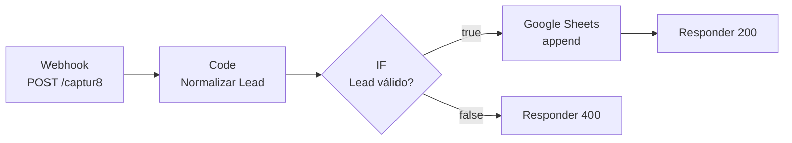

# 01 — Captur8

> **Lead de formulário entra pelo webhook, sai limpo na planilha, e quem mandou
> recebe uma resposta de verdade.**

O projeto nº 1 do laboratório. É o "olá mundo" útil do n8n: em vez de imprimir
texto na tela, ele abre um endereço na internet que fica esperando dados chegarem.

| | |
|---|---|
| **Gatilho** | Webhook `POST /captur8` |
| **Nós** | 6 + 1 post-it |
| **Credencial** | Google Sheets (OAuth2) |
| **Tempo** | ~25 min, sendo 15 só de OAuth |
| **Arquivo** | [`workflow.json`](workflow.json) |

---

## O fluxo



Quatro decisões dentro desse desenho pequeno:

1. **Normalizar antes de gravar.** Planilha com `(11) 9 8765-4321`, `11987654321` e
   `+5511987654321` na mesma coluna é planilha que não dá pra cruzar com nada.
2. **Validar antes de gravar.** Linha com e-mail quebrado é lixo que você vai ter que
   limpar depois, na mão.
3. **Responder de verdade.** `200` com o lead ecoado, `400` com o motivo. Formulário
   que recebe `200` pra tudo não tem como mostrar erro pro visitante.
4. **Retry na planilha, não na validação.** A API do Google falha por rede de vez em
   quando — isso merece 3 tentativas. E-mail torto não melhora na segunda tentativa.

---

## Passo a passo

### 1. Montar a planilha primeiro

O nó do Google Sheets grava por **nome de coluna**. Se o cabeçalho não existir, ele
não tem onde encaixar o dado. Então a planilha vem antes do fluxo.

Crie uma planilha, renomeie a primeira aba para `Leads` e ponha na **linha 1**, uma
por coluna, exatamente nesta grafia:

```
recebido_em | nome | email | telefone | tipo_telefone | origem | mensagem
```

Guarde o **ID da planilha** — é o pedaço comprido da URL:

```
https://docs.google.com/spreadsheets/d/  1AbC...XyZ  /edit
                                        └─── isso ───┘
```

### 2. Criar a credencial do Google

A parte mais chata, e a única que não é n8n. Em resumo:

1. No [Google Cloud Console](https://console.cloud.google.com), crie um projeto.
2. **APIs e serviços → Biblioteca**: ative **Google Sheets API** e **Google Drive API**
   (sim, as duas — o n8n usa o Drive pra listar as planilhas no menu).
3. **Tela de permissão OAuth**: tipo *Externo*, preencha o mínimo e adicione o seu
   próprio e-mail em **Usuários de teste**.
4. **Credenciais → Criar → ID do cliente OAuth → Aplicativo da Web.**
5. Em **URIs de redirecionamento autorizados**, cole a URL que o **n8n** te mostra
   no campo *OAuth Redirect URL* (copie de lá, não digite).
6. Copie *Client ID* e *Client Secret* para o n8n, em
   **Credentials → New → Google Sheets OAuth2 API**, e clique em *Sign in with Google*.

> Se der `Error 400: redirect_uri_mismatch`, é o passo 5: a URL no Google tem que ser
> idêntica à do n8n, até a barra final.

### 3. Importar o fluxo

**⋯ → Import from File →** [`workflow.json`](workflow.json)

Depois ajuste os dois pontos marcados no nó **Gravar na Planilha**:

- *Credential to connect with* → a credencial que você acabou de criar
- *Document ID* → troque `TROQUE_PELO_ID_DA_SUA_PLANILHA` pelo ID do passo 1
- *Sheet* → escolha `Leads` no menu

### 4. Entender o que o nó de código faz

Abra o nó **Normalizar Lead**. Ele resolve três coisas:

**a) O payload chega dentro de `body`.** O nó Webhook não entrega o JSON cru: entrega
um envelope com `headers`, `params`, `query` e `body`. O conteúdo está no `body`.
É por isso que a primeira linha útil é:

```js
const corpo = item.json.body ?? item.json;
```

O `?? item.json` é pra o mesmo código funcionar quando você testa o nó com dado
colado na mão, sem envelope.

**b) Telefone brasileiro não se normaliza com uma regra só.** A versão ingênua
(`tem 11 dígitos e o terceiro é 9 → celular, senão fixo`) joga fora número bom:

- Antes do nono dígito, celular tinha **8 dígitos** e começava em **6, 7, 8 ou 9**.
  Fixo começa em **2 a 5**. Então `11 98765432` é celular em formato antigo — só
  precisa do `9` inserido depois do DDD, não ser descartado.
- E **fixo tem WhatsApp**: o WhatsApp Business valida linha fixa por chamada de voz,
  e é justamente a loja de rua que atende no fixo.

Por isso o código **classifica** (`celular`, `fixo`, `invalido`) em vez de filtrar, e
grava a classificação numa coluna. Quem decide o que fazer com fixo é você, depois,
olhando os dados — não o fluxo, jogando fora na entrada.

**c) Chave de idempotência.** O campo `chave` recebe o e-mail (ou o telefone, se não
houver e-mail). Se o formulário disparar duas vezes — e ele vai, gente clica duas
vezes em botão — você consegue reconhecer o duplicado depois. O fluxo não deduplica
sozinho: gravar duas linhas e saber que são a mesma é melhor que perder uma e não saber.

### 5. Testar

Abra o nó **Entrada do Lead** e clique em **Listen for test event**. O n8n fica
esperando. Em outro terminal:

```bash
curl -X POST http://localhost:5678/webhook-test/captur8 \
  -H "Content-Type: application/json" \
  -d '{
    "nome": "Ana Souza",
    "email": "ANA@Exemplo.com.br",
    "telefone": "(11) 98765-4321",
    "origem": "instagram",
    "mensagem": "Quero saber o preço"
  }'
```

Resposta esperada:

```json
{
  "ok": true,
  "mensagem": "Lead recebido",
  "lead": {
    "nome": "Ana Souza",
    "email": "ana@exemplo.com.br",
    "telefone": "11987654321",
    "tipo_telefone": "celular"
  }
}
```

Repare: o e-mail voltou minúsculo e o telefone sem pontuação. Essa é a normalização
funcionando. Confira a linha nova na planilha.

Agora o caminho ruim:

```bash
curl -X POST http://localhost:5678/webhook-test/captur8 \
  -H "Content-Type: application/json" \
  -d '{"nome": "", "email": "nao-e-email", "telefone": "123"}'
```

```json
{ "ok": false, "erro": "nome ou email invalido" }
```

Com status `400`. Nada foi para a planilha. O script [`testar.sh`](testar.sh) roda
os dois casos de uma vez.

### 6. Ativar

Chavinha **Active** no topo. A partir daí o endereço de produção existe:

```
http://localhost:5678/webhook/captur8
```

(sem o `-test`). É essa URL que vai no formulário.

---

## Erros que eu encontrei

| Sintoma | Causa | Correção |
|---------|-------|----------|
| `404 not registered for POST` | chamei a URL de teste sem *Listen for test event*, ou a de produção sem ativar | ligue o listen, ou ative o workflow e tire o `-test` da URL |
| Todos os campos vazios na planilha | usei `{{ $json.nome }}` esperando o JSON cru; o conteúdo está em `body` | `{{ $json.body.nome }}`, ou um nó de código que desembrulha (o que o fluxo faz) |
| `The resource you are requesting could not be found` no Sheets | ID da planilha errado, ou a conta do OAuth não tem acesso a ela | confira o ID na URL; compartilhe a planilha com a conta que autorizou |
| Colunas em branco mesmo com dado chegando | cabeçalho da planilha com grafia diferente (`e-mail` ≠ `email`) | o nome da coluna tem que bater caractere por caractere |
| `redirect_uri_mismatch` | URI de redirecionamento do Google diferente da do n8n | copie do n8n e cole no Google, sem editar |
| Lead duplicado na planilha | o visitante clicou duas vezes | esperado; é pra isso que existe a coluna `chave` |

---

## O que eu mudaria num uso real

- **Deduplicar de fato**: ler a planilha antes de gravar e atualizar em vez de
  inserir, quando a `chave` já existir. Dá pra fazer no próprio nó do Sheets, com
  operação *Append or Update* e *Column to match on* = `chave`.
- **Avisar alguém**: um nó de Telegram ou e-mail depois do Sheets, com o lead novo.
  O fluxo do [Notific8](../02-notific8/) mostra o nó do Telegram montado.
- **Planilha não é banco**. Passa de alguns milhares de linhas, a API do Sheets fica
  lenta e o limite de requisição começa a aparecer. Nessa hora troque o nó por
  Postgres/Baserow — e o resto do fluxo continua igual, que é a vantagem de ter
  separado "normalizar" de "gravar".

---

← [Subindo o n8n](../docs/00-subindo-o-n8n.md) · [Glossário](../GLOSSARIO.md) ·
[Notific8 →](../02-notific8/)
