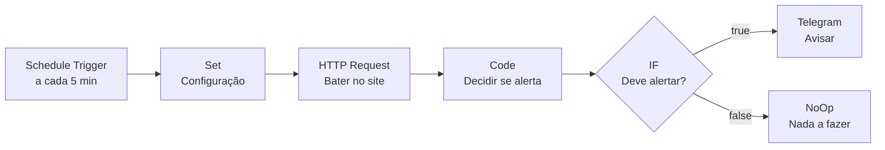

# 02 — Notific8

> **De 5 em 5 minutos o fluxo bate no site. Caiu, chega mensagem no Telegram.
> Voltou, chega também. E não chega mais nada no meio.**

O projeto nº 2 é o oposto do nº 1. No Captur8 alguém chama o fluxo; aqui ninguém
chama — o relógio dispara. É a diferença entre **webhook** e **polling**, e é o
projeto onde aparece a primeira coisa difícil de verdade do n8n: guardar memória
entre execuções.

| | |
|---|---|
| **Gatilho** | Schedule Trigger (a cada 5 min) |
| **Nós** | 7 + 1 post-it |
| **Credencial** | Telegram Bot (token do BotFather) |
| **Tempo** | ~20 min |
| **Arquivo** | [`workflow.json`](workflow.json) |

---

## O fluxo



O nó **Configuração** existe por um motivo: ele guarda a URL vigiada e o texto
esperado num lugar só. O nó HTTP usa `{{ $json.url }}` e o nó de código usa
`$('Configuracao').first().json.url`. Pra vigiar outro site, você muda **um** nó, não
três. É o equivalente a não espalhar o mesmo número mágico pelo código inteiro.

---

## Passo a passo

### 1. Criar o bot do Telegram

1. No Telegram, fale com **[@BotFather](https://t.me/botfather)**.
2. `/newbot` → escolha um nome e um usuário terminado em `bot`.
3. Ele devolve um **token** no formato `8123456789:AAH...`. Esse é o segredo.
4. No n8n: **Credentials → New → Telegram API** → cole o token.

### 2. Descobrir o seu `chat_id`

O bot não pode começar conversa — **você** tem que falar com ele primeiro. Então:

1. Abra a conversa com o seu bot e mande qualquer coisa (`oi`).
2. No navegador, abra:
   ```
   https://api.telegram.org/bot<SEU_TOKEN>/getUpdates
   ```
3. Procure `"chat":{"id":123456789`. Esse número é o seu `chat_id`.

> Vazio? Você não mandou a mensagem, ou mandou antes de criar o bot. Mande de novo
> e recarregue.
>
> Pra alertar um **grupo**: adicione o bot ao grupo, mande uma mensagem lá, e o
> `getUpdates` vai trazer um id **negativo** (ex. `-1001234567890`). Use ele.

### 3. Importar e configurar

**⋯ → Import from File →** [`workflow.json`](workflow.json)

Três campos pra trocar:

| Nó | Campo | Valor |
|----|-------|-------|
| **Configuracao** | `url` | o site que você quer vigiar |
| **Configuracao** | `texto_esperado` | uma palavra que **sempre** aparece na home |
| **Avisar no Telegram** | `Chat ID` | o número do passo 2 |
| **Avisar no Telegram** | credencial | a do passo 1 |

Sobre o `texto_esperado`: escolha algo do conteúdo, não do layout. O nome do seu
produto, o telefone, o CNPJ no rodapé. Não escolha palavra que o site troca
(data, contador, "Promoção de outubro") — senão você vai receber alerta de queda
na virada do mês.

### 4. O nó HTTP e as duas opções que mudam tudo

Abra **Bater no site → Options**. Duas coisas estão ligadas ali:

**`Never Error`** — a mais importante do projeto inteiro. Sem ela, um site caído faz
o nó HTTP lançar erro, a execução morre em vermelho, e **o alerta nunca sai**. O
fluxo cujo trabalho é avisar que o site caiu morria junto com o site. Com a opção
ligada, a falha vira dado: chega um `statusCode` pro nó seguinte avaliar.

**`Full Response`** — faz o nó devolver `statusCode`, `headers` e `body` em vez de só
o corpo. Sem isso você não tem o código de status pra conferir.

**`Timeout: 10000`** — 10 segundos e desiste. Sem timeout, um servidor que aceita a
conexão e nunca responde deixa a execução pendurada.

### 5. Entender o anti-flood

Esse é o coração do projeto. Abra **Decidir se alerta**.

A primeira versão que eu montei funcionava: site caído → mensagem no Telegram.
O problema é que ela funcionava **a cada 5 minutos**. Site fora do ar durante uma
manhã = 100 mensagens iguais. Notificação que vira ruído é notificação que você
desliga, e aí a automação virou zero.

A solução não é piorar a condição do alerta. É o fluxo **lembrar** o que já avisou:

```js
const estado = $getWorkflowStaticData('global');
```

`$getWorkflowStaticData('global')` devolve um objeto que o n8n grava junto do
workflow e entrega de volta na execução seguinte. O que você escrever nele
sobrevive ao fim da execução. É a única memória persistente que um fluxo tem sem
precisar de banco de dados.

Com isso, a regra fica:

| Estado anterior | Agora | Avisa? |
|---|---|---|
| ok | ok | não |
| ok | ruim | **sim** — "CAIU" |
| ruim | ruim | só de hora em hora — "AINDA CAIDO" |
| ruim | ok | **sim** — "VOLTOU" |

Três mensagens numa manhã de queda, em vez de cem. E o "VOLTOU" é o que você mais
quer: é ele que te deixa parar de olhar.

> **Pegadinha:** o estado só é gravado em execução de **produção**. Rodando o fluxo
> manualmente com o botão de teste, o `staticData` não persiste — o que faz parecer
> que o anti-flood não funciona. Ele funciona; é o modo de teste que não guarda.

### 6. O "200 mentiroso"

A outra coisa que esse código checa:

```js
else if (conf.texto_esperado && !corpo.includes(conf.texto_esperado)) {
  problema = 'respondeu 200 sem "' + conf.texto_esperado + '" na pagina';
}
```

Site pode responder `200 OK` entregando página de erro: banco de dados fora,
PHP quebrado, deploy pela metade, página branca. Monitor que olha só o código de
status dá tudo verde enquanto o cliente vê tela de erro. Procurar um texto que
*tem* que estar lá pega esse caso.

### 7. Testar sem esperar o site cair

Não precisa derrubar nada. Três testes:

**a) Caminho bom** — clique em *Test workflow*. O nó de código deve sair com
`alertar: false` e `problema: "nenhum"`. Nada no Telegram, e está certo.

**b) Caminho ruim, forçado** — no nó **Configuracao**, troque o `texto_esperado`
por algo que não existe na página (`banana-voadora`). Rode. Agora `alertar: true`,
`assunto: "CAIU"`, e a mensagem chega no Telegram. Desfaça depois.

**c) URL morta** — troque a `url` por `https://dominio-que-nao-existe-123456.com.br`.
Rode. Tem que dar `codigo: 0`, `problema: "sem resposta (timeout ou DNS)"` e a
execução precisa terminar **verde**. Se terminar vermelha, o *Never Error* está
desligado.

O teste (c) é o que vale: ele prova que o fluxo sobrevive à falha que ele existe
pra detectar.

### 8. Ativar

Chavinha **Active**. O Schedule Trigger só roda com o workflow ativo — fluxo
inativo com trigger de relógio não faz nada e não avisa que não está fazendo.

Depois do primeiro dia, abra **Executions** e confira: devem estar lá 12 execuções
por hora, quase todas terminando no nó *Nada a fazer*. É assim que se parece um
monitor saudável.

---

## Erros que eu encontrei

| Sintoma | Causa | Correção |
|---------|-------|----------|
| Execução vermelha quando o site cai, sem alerta | `Never Error` desligado no nó HTTP | ligue em *Options → Response → Never Error* |
| `$json.statusCode` vem `undefined` | `Full Response` desligado | ligue em *Options → Response → Full Response* |
| `Bad Request: chat not found` | `chat_id` errado, ou você nunca falou com o bot | mande mensagem pro bot e pegue o id no `getUpdates` |
| `Forbidden: bot was blocked by the user` | você bloqueou o bot em algum momento | desbloqueie na conversa |
| 12 mensagens por hora | é o fluxo sem anti-flood — ou o estado não está persistindo | confira que está rodando **ativo**, não em teste |
| Cron no horário errado | fuso do contêiner em UTC | `-e GENERIC_TIMEZONE="America/Sao_Paulo"` |
| Alerta na virada do mês, sem queda nenhuma | `texto_esperado` era texto que muda | escolha algo fixo (CNPJ, telefone, nome do produto) |

---

## O que eu mudaria num uso real

- **Vigiar vários sites** sem duplicar o fluxo: trocar o nó *Configuracao* por uma
  lista de URLs e deixar o n8n iterar — todo nó roda uma vez por item. O cuidado é
  que o `staticData` passaria a precisar de uma chave por site
  (`estado[url].problema`), senão um site derruba o estado do outro.
- **Avisar de latência**, não só de queda. O nó HTTP não devolve tempo de resposta;
  daria pra medir com um nó de código antes e outro depois comparando `Date.now()`.
- **Error Workflow**: em *Settings* do workflow dá pra apontar um fluxo que roda
  quando este quebra. Vale a pena justamente num monitor — quem vigia o vigia.

---

← [Captur8](../01-captur8/) · [Glossário](../GLOSSARIO.md) · [Valid8 →](../03-valid8/)
