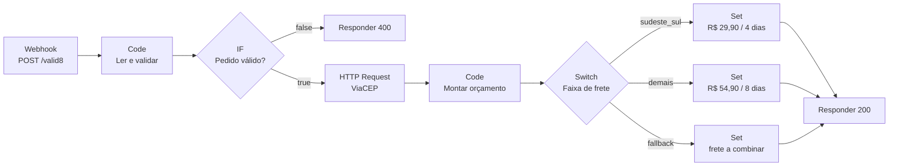

# 03 — Valid8

> **O cliente manda cliente, 8 dígitos de CEP e uma lista de itens. Volta endereço
> completo, subtotal, frete e prazo — em menos de um segundo, sem credencial nenhuma.**

O projeto nº 3 junta os dois anteriores e acrescenta a peça que falta: chamar uma
**API externa no meio do fluxo** e não perder o dado original no caminho. É o mais
completo dos três e o único que não precisa de token de nada.

| | |
|---|---|
| **Gatilho** | Webhook `POST /valid8` |
| **Nós** | 11 + 1 post-it |
| **Credencial** | nenhuma (ViaCEP é pública) |
| **Tempo** | ~15 min |
| **Arquivo** | [`workflow.json`](workflow.json) |

---

## O fluxo



---

## Passo a passo

### 1. Importar

**⋯ → Import from File →** [`workflow.json`](workflow.json)

E pronto — não tem nada pra configurar. Sem credencial, sem ID, sem token. Por isso
esse é um bom projeto pra testar se o seu n8n está de pé.

### 2. Validar antes de chamar a API

Abra **Ler e validar o pedido**. Ele limpa o CEP (`replace(/\D/g, '')`), filtra os
itens que têm SKU, quantidade e preço, calcula o subtotal, e no fim monta:

```js
const motivos = [];
if (cep.length !== 8) motivos.push('cep precisa de 8 digitos');
if (itensLimpos.length === 0) motivos.push('pedido sem item valido');
```

A ordem aqui é de propósito: **valida, depois chama**. CEP com 5 dígitos não precisa
virar requisição HTTP pra você descobrir que está errado. Em API pública, isso é
boa educação; em API paga ou com limite de chamadas, é a diferença entre funcionar
e levar bloqueio por abuso.

Note também que o nó devolve **todos** os motivos de uma vez, não o primeiro. Quem
está integrando com você não precisa descobrir os problemas um por rodada.

### 3. O erro que a API esconde no corpo

Abra **Consultar ViaCEP**. A URL é uma expressão:

```
=https://viacep.com.br/ws/{{ $json.cep }}/json/
```

O `=` na frente é o que diz ao n8n "isso aqui é expressão, calcule". Sem ele, o n8n
chamaria literalmente o endereço com `{{ $json.cep }}` no meio.

Agora a parte que me pegou. CEP que não existe:

```bash
curl https://viacep.com.br/ws/99999999/json/
```

```json
{ "erro": "true" }
```

Com status **`200 OK`**. Não é `404`. Quem checa só o código de status conclui que
deu tudo certo e segue com um endereço vazio — e o cliente recebe orçamento sem
endereço nenhum. Por isso a checagem está no **corpo**:

```js
const naoEncontrado =
  cepInfo.erro === true || String(cepInfo.erro) === 'true' || !cepInfo.uf;
```

Três condições porque a ViaCEP já devolveu esse campo como *booleano* `true` e como
*string* `"true"` em versões diferentes, e o `!cepInfo.uf` é o cinto de segurança
pra qualquer formato novo. **Regra geral: olhe o corpo da resposta antes de confiar
no status.** Cada API inventa a sua própria forma de dizer "não achei".

### 4. Não perder o pedido na passagem pela API

Esse é o conceito novo do projeto. O nó HTTP **substitui** o item: depois dele, o
`$json` é a resposta da ViaCEP — rua, bairro, cidade. O pedido do cliente (itens,
subtotal, nome) sumiu do fluxo.

Sumiu do `$json`, não do workflow. Em **Montar orçamento**:

```js
const pedido = $('Ler e validar o pedido').first().json;   // o dado de 2 nós atrás
const cepInfo = $input.first().json;                        // a resposta da API
```

`$('Nome do nó')` alcança a saída de **qualquer** nó anterior já executado. É assim
que se junta "o que o cliente pediu" com "o que a API respondeu". Sem isso você
cairia na solução ruim de mandar o pedido inteiro como parâmetro pra API só pra ele
voltar junto.

> O nome dentro de `$()` tem que ser **exatamente** o nome do nó no canvas. Renomeou
> o nó? Toda expressão que o referencia quebra, e o erro aparece só na execução:
> `Referenced node is unexecuted`. É o custo de referenciar por nome.

### 5. O Switch e a saída de sobra

Abra **Faixa de frete**. Duas regras explícitas e uma saída extra:

| Saída | Condição | Frete |
|-------|----------|-------|
| `sudeste_sul` | `regiao = sudeste_sul` | R$ 29,90, grátis acima de R$ 299 · 4 dias |
| `demais` | `regiao = demais` | R$ 54,90, grátis acima de R$ 499 · 8 dias |
| `cep_nao_encontrado` | *fallback* | a combinar |

A terceira é o **fallback** (*Options → Fallback Output → Extra Output*): onde cai o
que não casou com regra nenhuma. Sem ela, o item com CEP inválido simplesmente para
ali — e o cliente fica esperando uma resposta que nunca vem, porque o `Respond to
Webhook` está depois. Fluxo sem fallback engole dado em silêncio, que é o pior tipo
de erro: o que não aparece em lugar nenhum.

O frete grátis mora numa expressão com ternário, dentro do nó Set:

```
={{ $json.subtotal >= 299 ? 0 : 29.9 }}
```

E os três nós Set estão com **Include Other Fields** ligado — senão eles descartariam
o pedido e sobraria só `frete` e `prazo` pra responder.

### 6. Testar

**Listen for test event** no nó **Pedido chega**, e:

```bash
curl -X POST http://localhost:5678/webhook-test/valid8 \
  -H "Content-Type: application/json" \
  -d '{
    "cliente": "Ana Souza",
    "cep": "01310-930",
    "itens": [
      { "sku": "CAD-001", "nome": "Cadeira", "qtd": 2, "preco": 149.9 },
      { "sku": "MES-010", "nome": "Mesa",    "qtd": 1, "preco": 89.9 }
    ]
  }'
```

```json
{
  "ok": true,
  "cliente": "Ana Souza",
  "endereco": {
    "cep": "01310-930",
    "logradouro": "Avenida Paulista",
    "bairro": "Bela Vista",
    "cidade": "São Paulo",
    "uf": "SP"
  },
  "subtotal": 389.7,
  "frete": 0,
  "total": 389.7,
  "prazo_dias_uteis": 4,
  "aviso": "frete gratis acima de R$ 299"
}
```

Subtotal R$ 389,70 passou de R$ 299 → frete zero. O CEP com traço funcionou porque
foi limpo antes de virar URL.

Os outros três casos (todos no [`testar.sh`](testar.sh)):

```bash
# CEP curto → 400, sem gastar chamada na ViaCEP
-d '{"cliente":"X","cep":"123","itens":[{"sku":"A","qtd":1,"preco":10}]}'
# → { "ok": false, "erro": "cep precisa de 8 digitos" }

# Pedido sem item válido → 400, com os dois motivos quando for o caso
-d '{"cliente":"X","cep":"01310930","itens":[]}'
# → { "ok": false, "erro": "pedido sem item valido" }

# CEP inexistente → 200, pelo fallback, com o aviso
-d '{"cliente":"X","cep":"99999999","itens":[{"sku":"A","qtd":1,"preco":10}]}'
# → { "ok": true, "endereco": null, "frete": 0,
#     "aviso": "CEP nao localizado na base dos Correios: frete a combinar" }
```

Vale rodar os quatro e abrir cada execução em **Executions** vendo por qual saída do
Switch o item passou. É o jeito mais rápido de entender roteamento condicional:
você vê a linha acender.

### 7. Ativar

**Active**, e a URL de produção passa a ser `http://localhost:5678/webhook/valid8`.

---

## Erros que eu encontrei

| Sintoma | Causa | Correção |
|---------|-------|----------|
| URL chamada com `{{ $json.cep }}` literal | esqueci o `=` na frente do campo | `=https://viacep.com.br/ws/{{ $json.cep }}/json/` |
| Endereço vazio e nenhum erro | CEP inexistente devolve `200` com `{"erro":"true"}` | checar o corpo, não o status |
| `Referenced node is unexecuted` | `$('Nome')` apontando pra nó que não rodou nessa execução (ou renomeado) | confira o nome; o nó referenciado tem que estar no caminho percorrido |
| Resposta só com `frete` e `prazo` | *Include Other Fields* desligado nos nós Set | ligue nos três |
| Cliente pendurado sem resposta | item caiu numa saída do Switch sem nada ligado | é pra isso que existe o fallback |
| `subtotal` com `389.70000000000005` | ponto flutuante | `Number(x.toFixed(2))`, como está no código |
| ViaCEP devolvendo `429` | muita chamada seguida no teste | ela tem limite por IP; espere, e use *pinned data* pra repetir teste sem bater na API |

---

## O que eu mudaria num uso real

- **Nunca confiar no preço que o cliente manda.** Aqui o `preco` vem no payload, o
  que é ótimo pra aprender e inaceitável em produção: qualquer um mandaria
  `"preco": 0.01`. O certo é receber só `sku` e `qtd` e buscar o preço no seu banco.
  Fica anotado como o defeito consciente deste exemplo.
- **Cache de CEP.** O mesmo CEP consultado toda hora é chamada desperdiçada. Uma
  tabela de CEPs já vistos resolve, e tira a ViaCEP do caminho crítico.
- **Frete de verdade** (Correios, Melhor Envio) em vez de tabela por região. A
  estrutura não muda: só troca o nó do Switch+Set por mais uma chamada HTTP — e o
  tratamento de "respondeu 200 mas não deu certo" você já sabe fazer.

---

← [Notific8](../02-notific8/) · [Glossário](../GLOSSARIO.md) · [Início](../README.md)
